# Adaptive AI Tutor

Agentic learning platform coordinating **12 specialized GPT-4o agents** for prerequisite curriculum planning, Socratic tutoring, misconception diagnosis, criterion-referenced rubric assessment, and Bayesian mastery tracking (**Next.js 14 App Router, TypeScript, PostgreSQL, Prisma**).

## Problem & Architecture

Single-prompt tutoring chatbots frequently fail in two opposite ways: they either dump complete answers (bypassing active retrieval) or advance learners into topics whose prerequisites are still shaky. **Adaptive AI Tutor** separates curriculum sequencing, instructional scaffolding, assessment, and pedagogical safety into 12 bounded agent roles backed by deterministic mastery math:

```mermaid
flowchart LR
    L["Learner Prompt / Submission"] --> G["12. Safety & Pedagogy Guard (PII + Anti-Injection)"]
    G --> C["1. Curriculum Planner (Kahn Prerequisite DAG)"]
    C --> D["2. Diagnostic Placement"]
    D --> T["3-6. Tutoring Agents (Explainer, Socratic, Worked Example, Code Lab)"]
    T --> A["7-9. Assessment Agents (Misconception, Formative Quiz, Criterion Rubric)"]
    A --> M["10. Mastery Tracker (Bayesian Knowledge Tracing)"]
    M --> S["11. Spaced Repetition Scheduler (SM-2)"]
    S --> DB[("PostgreSQL + Prisma ORM")]
```



### The 12 Coordinated Agents (`src/agents/registry.ts`)

| # | Agent ID | Stage | Responsibility |
|---|---|---|---|
| 1 | `curriculum_planner` | Curriculum | Kahn topological sort & Zone-of-Proximal-Development (`P(L_t) >= 0.85` prerequisites) selection |
| 2 | `diagnostic_placement` | Curriculum | Adaptive midpoint diagnostic probes to initialize concept mastery priors |
| 3 | `concept_explainer` | Tutoring | Dual-representation conceptual synthesis (formal invariant + systems mental model) |
| 4 | `socratic_tutor` | Tutoring | Guided questioning verified by `verifySocraticResponse` anti-answer-dumping checks |
| 5 | `worked_example` | Tutoring | Isomorphic step-by-step worked examples with faded transfer steps |
| 6 | `code_lab_coach` | Tutoring | Minimal failing counterexamples and boundary-condition debugging prompts |
| 7 | `misconception_detector` | Assessment | Separates structural conceptual gaps from careless slips |
| 8 | `formative_quiz` | Assessment | Difficulty-calibrated constructed-response retrieval prompts |
| 9 | `rubric_evaluator` | Assessment | Multi-criterion rubric scoring with evidence-backed feedback |
| 10 | `mastery_tracker` | Assessment | Corbett & Anderson Bayesian Knowledge Tracing (`updateMasteryPosterior` + `stepsToMastery`) |
| 11 | `spaced_repetition` | Curriculum | SuperMemo-2 (`SM-2`) retention interval and easiness-factor scheduling |
| 12 | `safety_pedagogy_guard` | Governance | Prompt-injection screening, email PII redaction, and instructional integrity enforcement |

## Quickstart

```bash
npm install
npx prisma validate && npx prisma generate
npm run typecheck
npm test
npm run build
```

Configure `.env` from `.env.example` (`DATABASE_URL` for PostgreSQL and `OPENAI_API_KEY` for live `gpt-4o` completions; offline deterministic pedagogical solvers run automatically in CI and local tests when `OPENAI_API_KEY` is omitted).

## API Endpoints

- `GET /api/agents` — Inspect all 12 registered agent specifications and stages.
- `POST /api/curriculum` — Compute topological curriculum order and unlocked Zone-of-Proximal-Development concepts from learner mastery state.
- `POST /api/tutor` — Execute a guarded multi-agent tutoring & mastery cycle.
- `POST /api/assess` — Run criterion-referenced rubric evaluation and Bayesian Knowledge Tracing updates.

## Author & License

Authored by **Nagarjuna Kamireddy** ([writetonagarjuna@gmail.com](mailto:writetonagarjuna@gmail.com) · [GitHub](https://github.com/nagarjunak-pixel) · [LinkedIn](https://www.linkedin.com/in/nagarjuna-kamireddy)). Released under the **Apache-2.0 License**.
